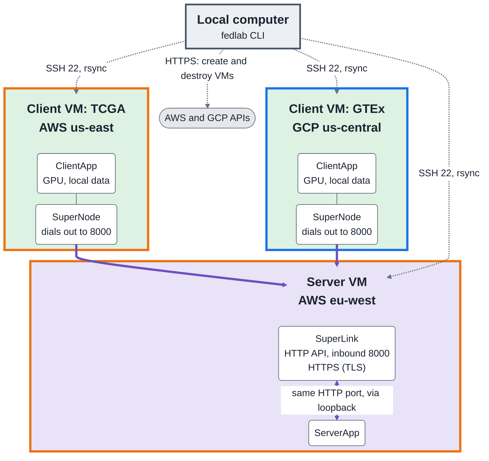
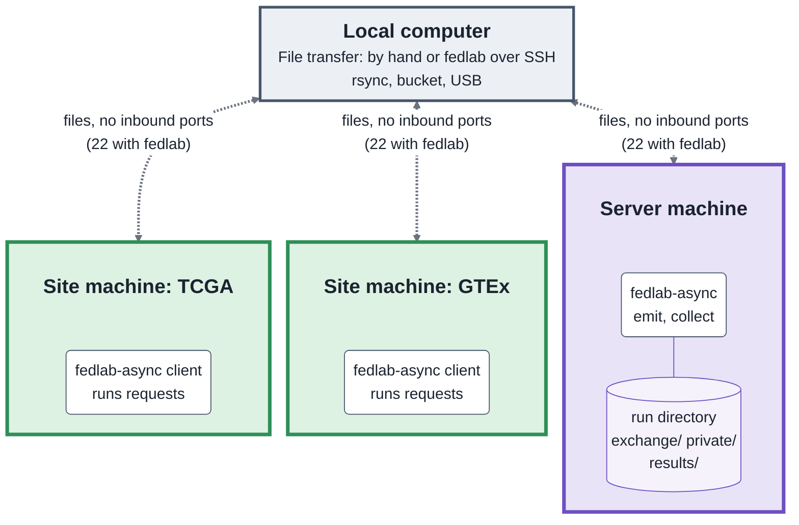

# fedlab

fedlab runs federated-learning experiments on AWS and GCP. It starts the VMs, installs an experiment, runs it, copies the results to your machine, and removes the VMs.

An experiment is a **module**. The module `compass_tcga_gtex` trains the COMPASS foundation model on TCGA and GTEx with [Flower](https://flower.ai). The module `compass_tcga_gtex_async` runs the same training as files instead of connections (see [File-based runs](docs/file-based-runs.md)). `smoke` is a tiny numpy FedAvg that checks provisioning, TLS, and result collection.

## Default fleet

One server and two GPU clients. Each VM has a 200 GB disk and runs Ubuntu 22.04 on-demand.

| node | role | site | where | type | spec |
|---|---|---|---|---|---|
| `fedlearn-server-aws-eu-west-1` | server | - | AWS eu-west-1 | r6i.large | 2 vCPU / 16 GB |
| `fedlearn-client-aws-us-east-1` | client | tcga | AWS us-east-1 | g4dn.4xlarge | 16 vCPU / 64 GB, 1x T4 |
| `fedlearn-client-gcp-us-central1-a` | client | gtex | GCP us-central1-a | n1-highmem-8 + T4 | 8 vCPU / 52 GB, 1x T4 |

Exactly one node must have `role: server`. A client with a `site` holds the data of that site. Destroy the fleet when it is idle.

## Architecture

### Live run (Flower)

### File-based run (`fedlab-async`)

|  | Live (Flower) | File-based |
|---|---|---|
| Server inbound | 22, 8000 (TCP) | none (22 if `fedlab` drives it over SSH) |
| Client inbound | 22 | none (22 if `fedlab` drives it over SSH) |
| Client outbound | to server:8000 | none |
| Protocol | HTTPS (TLS) | files; any transport |
| Who connects | clients dial the server | nobody |
| Authentication | per-node keys, private CA | hash, nonce, and sequence number in each file |
| Encryption | TLS | left to the transport |
| After a VM restart | IPs change; run `deploy` again | nothing to redo |
| Both ends online together | yes | no |

## Setup

1. Make sure that `ssh` and `rsync` are on your machine.
2. Install the packages: `uv sync`
3. Copy `.env.example` to `.env`. Add the AWS keys (or `AWS_PROFILE`) and `GCP_PROJECT`.
4. Log in to GCP: `gcloud auth application-default login`
5. Copy `config.example.yaml` to `config.yaml`. Set `module` and `module_options`.

Environment variables `FEDLAB_<KEY>` and `.env` override `config.yaml`.

## Run an experiment

Run `uv run fedlab check`, then `uv run fedlab prepare` (for modules with a local step), then `uv run fedlab experiment`. `experiment` destroys the fleet only after `collect` succeeds. If a step fails, it keeps the fleet, so you can read the logs. Then run `fedlab destroy`. Options:

- `--keep` leaves the fleet running after success.
- `--destroy-on-failure` also destroys the fleet after a failure.
- `--yes` skips the confirmation.

## Commands

Run each command with `uv run fedlab <command>`.

| command | action |
|---|---|
| `check` | Test credentials, permissions, quotas, instance types, and the configuration of the module. It creates nothing. |
| `modules` | List the available modules. |
| `prepare` | Run the local preparation step of the module. It uses no cloud. |
| `up` | Create all VMs, start stopped VMs, and wait for SSH. You can run it again safely. |
| `deploy` | Wait for the VMs to finish first boot. Install the software and data of the module. Start the federation. |
| `run` | Run the deployed experiment to completion. |
| `collect` | Copy the results and service logs to `results/<run_name>/<timestamp>/`. Use `--out` to choose the directory, or set `results_dir` in the config. |
| `logs <node> [superlink\|supernode]` | Show the Flower service log of a node. `--lines` sets the length. |
| `experiment` | `up`, `deploy`, `run`, `collect`, `destroy`. With `federation: orchestrated` it also makes and removes the orchestrator. |
| `orchestrator up\|down\|status` | Make, remove, or show the orchestrator VM for orchestrated runs. |
| `report` | Compare runs: a table (CSV, JSON, markdown) and a chart page built from each run's metrics. |
| `build-image` | Build the node images for `linux/amd64` and push them to quay.io. |
| `status`, `ping` | Show node states and IPs. Test SSH login on each node. |
| `start`, `stop` | Start or stop VMs. Stopped VMs still pay for their disks. |
| `ssh <node> [command]` | Open SSH to a node with the repo key. |
| `destroy` | Delete all resources of this run. Add `--dry-run` to list them only. |

`up`, `start`, `stop`, `ping`, and `check` accept `-n <node>` (repeat it for more nodes). All other commands act on the whole fleet. Every command except `modules` accepts `-c <file>` for a config file.

## More

- [The COMPASS module](docs/compass-module.md): options, data preparation, results, differences from the original scripts
- [File-based runs](docs/file-based-runs.md): `fedlab-async` server and site commands, the COMPASS example, running it on a fleet
- [Orchestrated runs](docs/orchestrated-runs.md): one SuperLink for each request on a separate orchestrator, nodes that only dial out, the node images
- [Metrics](docs/metrics.md): what every run records on every host
- [Add a module](docs/add-a-module.md): the `FLModule` interface
- [Operations](docs/operations.md): Flower deployment, local files, GPUs, ports and security, teardown
- [Tests](docs/testing.md)
